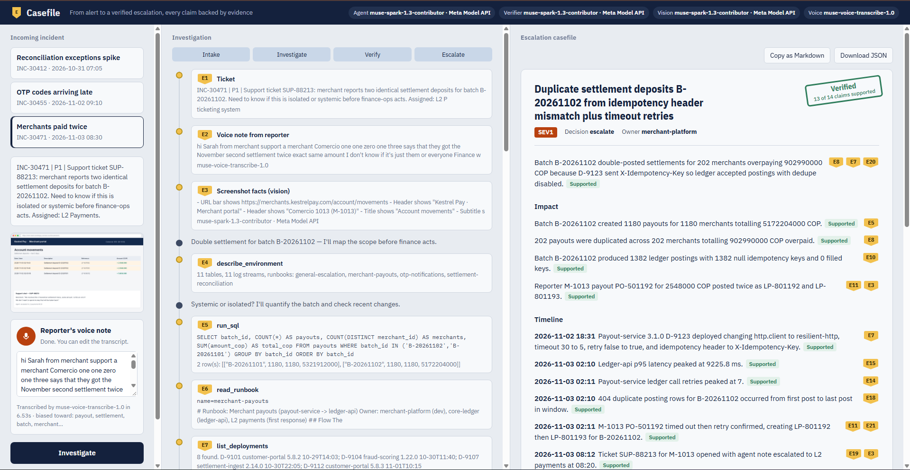
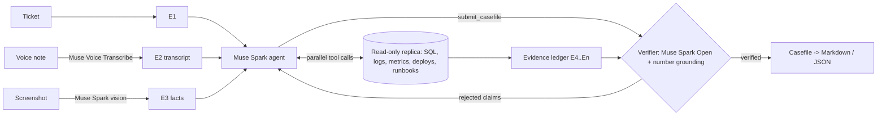

# Casefile

**An autonomous L2 incident investigator for payment platforms. It turns an alert, a voice note and a screenshot into a verified escalation where every claim cites the evidence that proves it.**

Built for the Meta Global AI Developer Hackathon (track: *Build for Your World*).



## The problem

In production support for payments, the first responder (L2) does not fix code. Their job is to gather evidence, find what changed, measure the impact and escalate to the development team with enough proof that the developers can act immediately.

That work is slow and inconsistent. Reports arrive as voice notes from the call center and screenshots of dashboards. The investigation is a manual loop of SQL queries, log searches, metric checks and deployment history. And the escalation that reaches developers is often a guess ("the provider is down", "the file was late") that sends them in the wrong direction, while customers cannot log in or merchants are paid twice.

## What Casefile does

1. **Intake as it really arrives.** The reporter's voice note is transcribed by **Muse Voice Transcribe** with keyword biasing for payments jargon. The attached screenshot is read by **Muse Spark** image understanding, and its visible facts become citable evidence.
2. **Autonomous investigation.** A **Muse Spark** agent with parallel tool calling explores a read-only production replica: SQL, structured logs, metrics, deployments with config diffs, and runbooks. It quantifies impact, finds the change that lines up, and actively tries to disprove the reporter's guess.
3. **Evidence ledger.** Every tool result gets an evidence ID (`E7`). The agent must cite IDs for every statement in the casefile.
4. **Independent verification.** Before escalation, a separate verifier (which can run on **Muse Spark Open**, a different model and deployment) judges each claim only against the evidence it cites. A deterministic check also rejects any number that does not appear in the cited evidence. Rejected claims go back to the agent, which investigates further and resubmits.
5. **Escalation.** The verified casefile (impact, timeline, probable root cause with confidence, what was ruled out, next actions per team, and queries the dev team can run to confirm) exports to Markdown for Jira, GitHub or Slack.

## Why it matters

- Developers get a ticket they can act on without a single follow-up question.
- Wrong escalations are blocked: in each sandbox incident the reporter's hypothesis is wrong (late file, provider outage), and the agent has to prove it.
- The verifier makes the agent's output auditable, which is the bar for anything touching money movement.

## Meta models used

| Model | Where | How |
| --- | --- | --- |
| Muse Spark (`muse-spark-1.3`) via Meta Model API | Investigation agent | Chat Completions with parallel tool calls, reasoning effort, multimodal input (ticket screenshot attached to the first turn) |
| Muse Spark image understanding | Intake | Extracts the literal facts on the screenshot into evidence `E3` |
| Muse Voice Transcribe (`muse-voice-transcribe-1.0`) | Intake | `POST /v1/asr/transcribe` with keyword and language biasing; audio is recorded and encoded to 16 kHz WAV in the browser |
| Muse Spark Open (`meta-models/muse-spark-open-1026`) on Baseten | Verifier (or the whole pipeline) | Same OpenAI-compatible client; any role can be switched to the open-weight model with one env var |

## The sandbox (100% synthetic)

Kestrel Pay is a fictional payments company. `sandbox/build_sandbox.py` generates a deterministic replica with 11 tables, 11 log streams, metrics, deployments and runbooks, plus routine noise and unrelated deployments. It contains three incidents. Each one needs evidence from several sources and has a red herring:

| Incident | What the reporter believes | What the evidence shows |
| --- | --- | --- |
| Reconciliation exceptions spike (635 vs. threshold 25) | The processor file arrived late | A parser refactor changed `parser.timestamp_source_tz` from UTC to local time, so every transaction after 19:00 lands on the next business date |
| OTP codes arriving minutes late | The SMS provider has an outage | The provider's degradation was in APAC; provider latency is flat. A cost-saving change set `consumer.max_workers` from 12 to 2 during business hours |
| Merchants paid twice (202 payouts, 902,990,000 COP) | Isolated merchant issue | payout-service 3.1.0 enabled retries on a 5 s timeout and renamed the idempotency header that ledger-api reads, during the ledger's index-rebuild window |

No real company, customer or production data is used anywhere.

## Run it

```bash
git clone <this repo> && cd casefile
python -m venv .venv && source .venv/bin/activate
pip install -r requirements.txt
cp .env.example .env          # add MODEL_API_KEY (and BASETEN_API_KEY for the open-weight model)
python scripts/smoke_test.py  # checks chat, tool calling and vision against your key
uvicorn casefile.server:app --port 8000
```

Open http://localhost:8000, pick an incident, optionally record the voice note, and press **Investigate**. The synthetic data is generated on first start.

Terminal version: `python -m casefile.cli otp-delay`

### Run on Meta open weights

```bash
# whole pipeline on Muse Spark Open (Baseten)
LLM_PROVIDER=baseten uvicorn casefile.server:app
# agent on Muse Spark (Meta Model API), independent verifier on Muse Spark Open
AGENT_PROVIDER=meta VERIFIER_PROVIDER=baseten uvicorn casefile.server:app
```

`openai_compat` points any role at a self-hosted vLLM / SGLang server running Muse Spark Open or Muse Glimmer.

### Tests

```bash
pytest -q   # uses an offline scripted model; no API calls
```

## Architecture



| Path | What it is |
| --- | --- |
| `casefile/agent.py` | Intake, agent loop, evidence ledger, verifier, revision loop |
| `casefile/tools.py` | Read-only tools (SQLite authorizer allows SELECT only; 5 s query budget; 40-row cap) and their JSON schemas |
| `casefile/llm.py` | One OpenAI-compatible client for Meta Model API, Baseten and self-hosted servers |
| `casefile/voice.py` | Muse Voice Transcribe file endpoint with biasing |
| `casefile/server.py` | FastAPI + server-sent events; saved runs can be replayed |
| `web/index.html` | The demo UI (no build step) |
| `sandbox/` | Synthetic data generator, screenshots, runbooks, incident tickets |

## Built during the hackathon

Everything in this repository was written during the hackathon building period (November 3–4, 2026): the sandbox and its three incidents, the agent and tools, the evidence ledger and verifier, the voice and vision intake, the server and the UI. No prior codebase is reused.

**AI use:** I wrote this project with Claude Code (Anthropic) as a coding assistant. At runtime, Casefile uses only Meta models.

## What's next

- Connectors for real observability stacks (Datadog, CloudWatch, Grafana) behind the same read-only tool interface.
- Post-training Muse Glimmer on accepted casefiles so the verifier can run on-premises, which banks require.
- Live voice intake over the realtime ASR endpoint with diarization, for incident bridges.

## License

MIT
